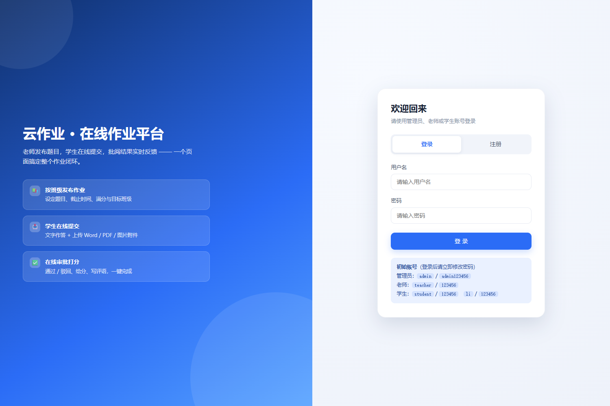
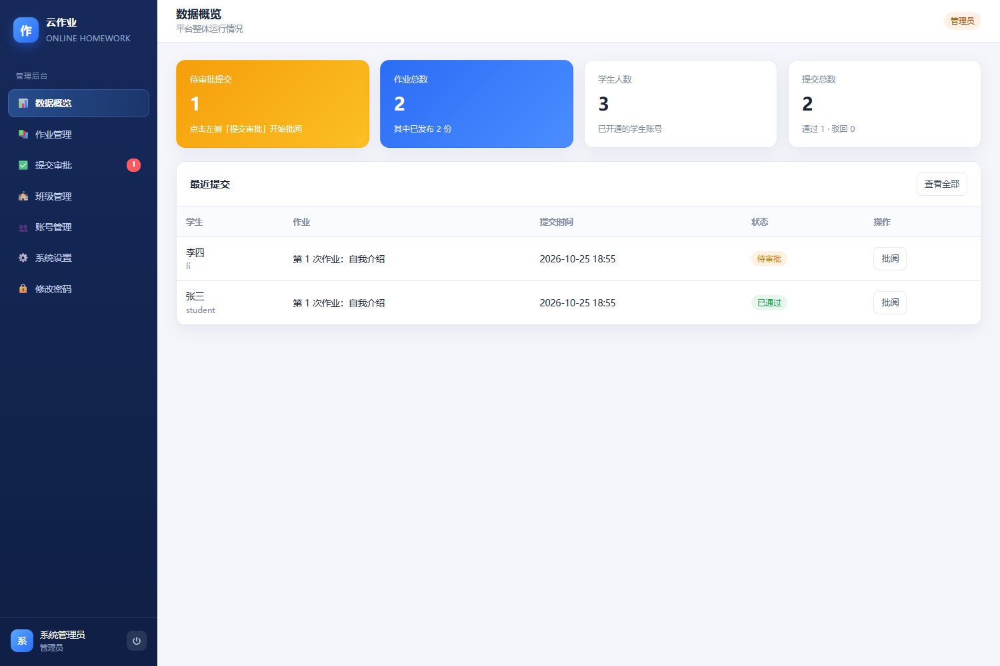
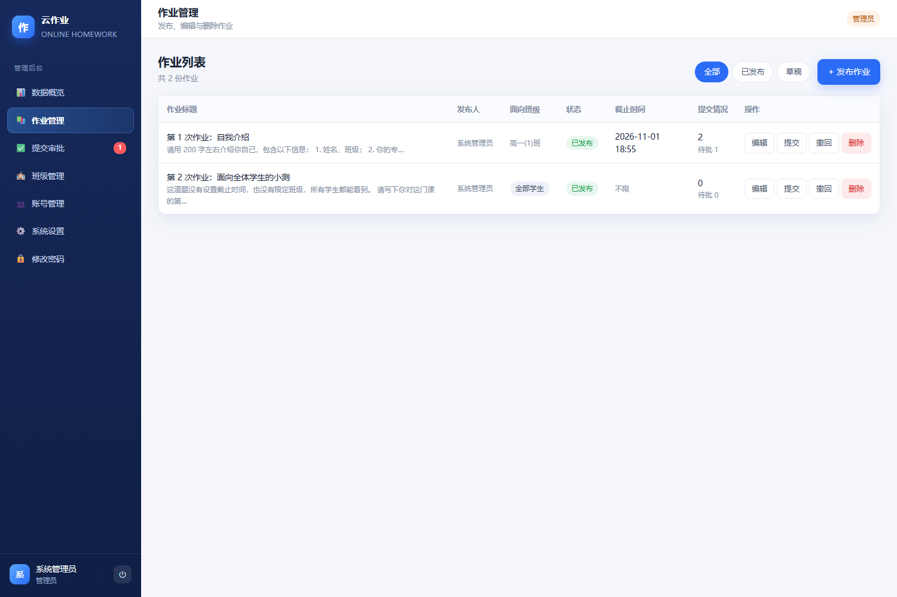
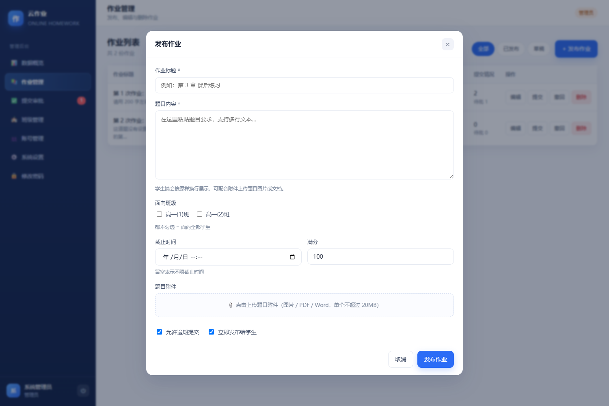
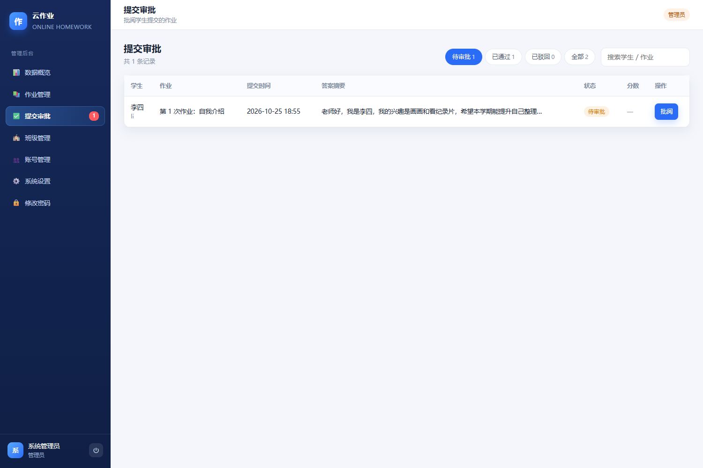
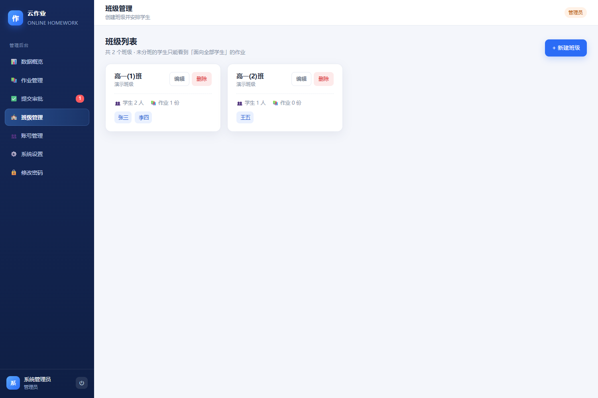
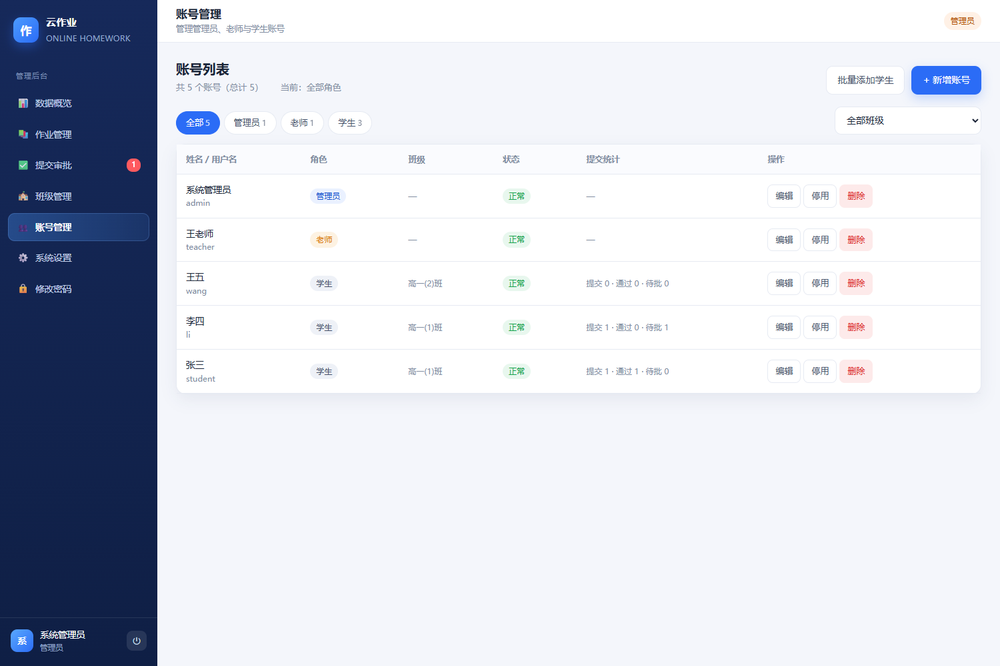
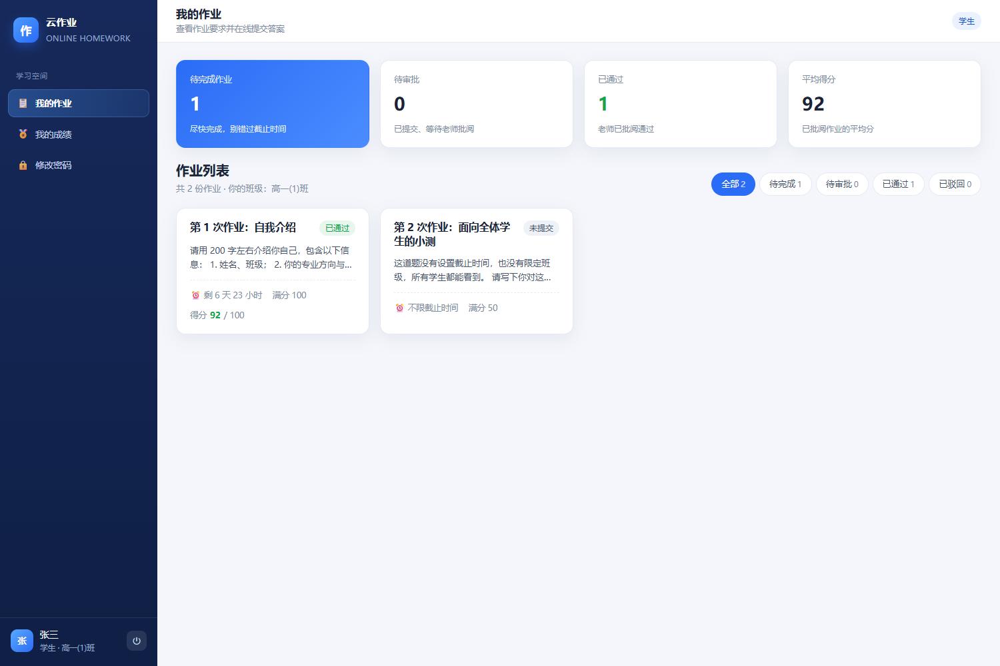
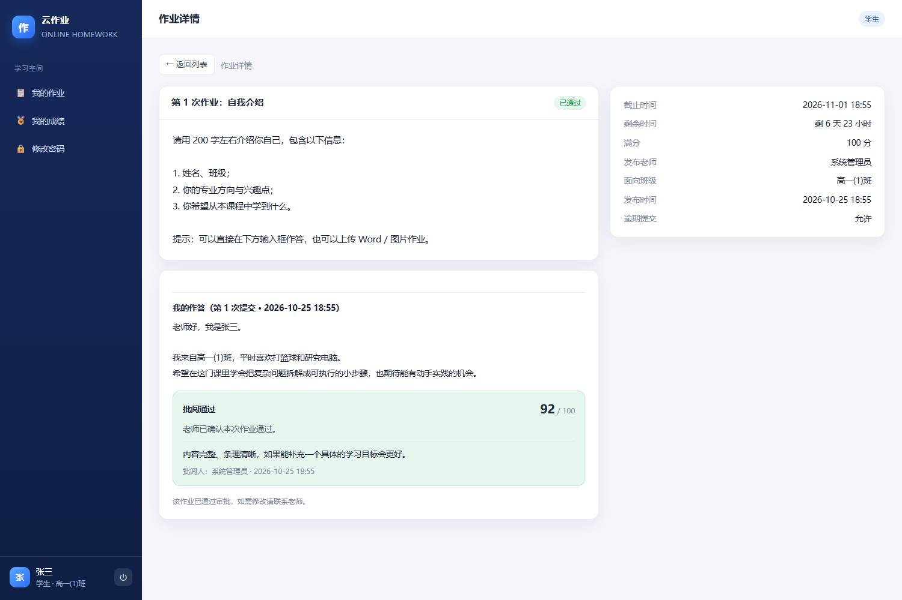

# 云作业 · 在线作业平台

> 一个类似「学习通」的轻量作业系统：**老师发布题目 → 学生上传答案 → 老师在线审批打分**。
> 原生 Node.js + 原生前端，零构建、零数据库，一条命令就能跑起来，也可以一键发布到公网让所有人访问。



---

## ✨ 功能一览

| 角色 | 能做什么 |
| --- | --- |
| **管理员** | 发布/编辑/删除作业、批阅所有提交、管理账号（管理员/老师/学生）、创建班级并分班、批量导入学生、开关学生自助注册、下载数据备份 |
| **老师** | 发布自己的作业（可选目标班级）、批阅**自己作业**的提交、查看自己的统计（看不到别人的作业和学生账号） |
| **学生** | 查看本班作业、在线文字作答 + 上传附件、查看审批结果与分数评语、老师批阅前可重新提交或撤回 |

其他细节：

- 📚 **按班级发布**：作业可指定 1 个或多个班级，未指定 = 面向全部学生；学生只看得到自己班的作业
- 🔑 **参考答案**：发布作业时可附参考答案，并设定学生可见时机（提交后 / 批阅后 / 截止后 / 不显示），老师批阅时始终可见
- 🙋 **学生自选班级**：管理员一键开关，开启后学生注册时可选班级，登录后也能自己切换
- ⏰ **截止时间**：自动倒计时、过期禁止提交（可设置「允许逾期提交」）
- ✍️ **在线审批**：通过 / 驳回 + 分数（自动校验不超过满分）+ 评语，可改评
- 📎 **附件上传**：图片 / PDF / Word / Excel / PPT / 压缩包，单文件默认 20MB，中文文件名正常
- 🔒 **安全**：scrypt 密码哈希、HMAC 签名会话 Cookie（HttpOnly）、接口级权限校验、登录限流、危险扩展名拦截
- 📱 **响应式**：电脑、平板、手机都能用
- 🗂 **零依赖运维**：数据存 `data/db.json`，附件存 `data/uploads/`，随时整目录复制即备份

---

## 🖼 界面预览

| 管理员 · 数据概览 | 作业管理 |
| --- | --- |
|  |  |

| 发布作业 | 提交审批 |
| --- | --- |
|  |  |

| 班级管理 | 账号管理 |
| --- | --- |
|  |  |

| 学生 · 我的作业 | 学生 · 作业详情（在线作答） |
| --- | --- |
|  |  |

---

## 🚀 快速开始（本机运行）

### 方式一：Windows 双击启动（最简单）

双击项目根目录下的 **`start.cmd`**，自动安装依赖、启动服务并打开浏览器。

### 方式二：命令行

```bash
npm install
npm start
```

看到下面的提示就成功了，浏览器打开 <http://localhost:3000>：

```
  作业平台已启动
  本机访问:   http://localhost:3000
  局域网访问: http://<本机IP>:3000
```

> 同一 WiFi 下的同学/老师可以用你电脑的局域网 IP（如 `http://192.168.1.8:3000`）访问。

### 初始账号

| 角色 | 用户名 | 密码 |
| --- | --- | --- |
| 管理员 | `admin` | `admin123456` |
| 老师 | `teacher` | `123456` |
| 学生（高一(1)班） | `student` | `123456` |
| 学生（高一(1)班） | `li` | `123456` |
| 学生（高一(2)班） | `wang` | `123456` |

> ⚠️ 为安全起见，**登录页不会显示这些初始账号**，只在服务启动时的命令行里打印一次，正式使用前请立刻修改管理员密码并处理演示账号。
> 想要「干净」的初始环境（只有管理员、没有演示数据）：启动前设置环境变量 `SEED_DEMO=0`。

### 📘 使用文档（Word）

`docs/` 目录里已经生成三份图文教程，可直接打印或发给老师和学生：

| 文档 | 读者 | 内容 |
| --- | --- | --- |
| `docs/1-云作业-发布部署指南.docx` | 管理员 / 运维 | 三种发布方式的完整图文步骤、环境变量、备份与故障排查 |
| `docs/2-云作业-管理员与教师使用手册.docx` | 管理员、老师 | 建班、加学生、发布作业（含参考答案）、批阅打分的分步图解 |
| `docs/3-云作业-学生使用手册.docx` | 学生 | 登录注册、选班级、提交作业、看成绩与参考答案、手机端操作 |

文档带编号标注截图，重新生成：`node scripts/build-docs.mjs`（截图脚本：`node scripts/capture-ui.mjs`）。

### 🧰 运维小工具

| 脚本 | 用途 |
| --- | --- |
| `npm test` | 83 项端到端自测（建议在干净数据下运行） |
| `node scripts/verify-deploy.mjs <站点> <管理员> <密码>` | 对线上实例做 28 项上线自检 |
| `node scripts/restore-deploy.mjs <站点> <管理员> <密码> <备份.json>` | 把备份恢复到线上（重新部署后救数据） |
| `node scripts/create-teachers.mjs <站点> <管理员> <密码> "wangls,王老师" ...` | 批量创建老师账号 |
| `node scripts/reset-password.mjs <用户名> <新密码>` | 本机重置密码（忘记管理员密码时） |

> 📱 手机端：左侧菜单会变成顶部一排按钮，**「退出登录」在右上角蓝色「退出」按钮**（桌面端在左下角 ⏻ 图标）。

---

## 📝 完整使用流程

1. **管理员建班级** → 左侧「班级管理 → 新建班级」，例如「高一(1)班」。
2. **加学生并分班** → 「账号管理 → 批量添加学生」，粘贴名单（每行 `学号,姓名`），勾选所属班级，统一初始密码。
3. **老师发布作业** → 「作业管理 → 发布作业」，填写标题、题目内容、截止时间、满分、**面向班级**，可上传题目附件。
4. **学生提交** → 学生登录后「我的作业」里打开作业，输入答案、上传附件，点「提交作业」。
5. **老师批阅** → 老师/管理员进「提交审批」→ 点「批阅」→ 看答案与附件 → 填分数和评语 → 「通过并保存」或「驳回」。
6. **学生查看结果** → 作业详情页显示「批阅通过 / 被驳回 + 分数 + 评语」；被驳回可修改后重新提交。

---

## 🌍 发布到公网（所有人都能打开）

### 方案 A：Render 免费部署（推荐，零成本拿到 https 公网地址）

前置：一个 GitHub 账号（免费注册）。

1. **把代码推到 GitHub**
   ```bash
   git init
   git add .
   git commit -m "first commit"
   git branch -M main
   git remote add origin https://github.com/你的用户名/homework-platform.git
   git push -u origin main
   ```
   > 只推代码即可，`data/`、`uploads/`、`node_modules/` 已在 `.gitignore` 里被忽略。

2. **在 Render 部署**
   - 打开 <https://render.com> → 用 GitHub 账号登录 → 授权访问仓库
   - 点右上 **New +** → **Blueprint**
   - 选择你的仓库 → Render 会自动读取 `render.yaml`
   - 在环境变量里填写 **`ADMIN_PASSWORD`**（自定义管理员密码，至少 8 位）
   - 点 **Apply / Deploy**，等待 1~3 分钟构建

3. **拿到网址**
   部署成功后 Render 会给你一个形如
   `https://homework-platform-xxxx.onrender.com`
   的地址 —— **把这个链接发给任何人，他们都能打开登录使用**。

4. 用 `admin` + 你刚刚设置的密码登录，第一时间在「系统设置」里确认注册开关、在「修改密码」里改密码。

> ⚠️ **免费实例的两个限制**（都很好规避）：
> 1. 15 分钟无人访问会进入休眠，下次打开需要等约 30 秒唤醒；
> 2. **磁盘是临时的**，重新部署/重启后 `data/` 会重置。
>    → 想要数据永久保存：升级到付费实例（约 $7/月）后，把 `render.yaml` 里 `disk:` 那 4 行注释打开、并把 `DATA_DIR` 设为 `/data`；
>    → 不想花钱：用「系统设置 → 下载数据备份」定期保存 JSON，重新部署后手动恢复（见下文「数据与备份」）。

### 方案 B：部署到自己的云服务器（数据永久保存，推荐长期使用）

适用：阿里云 / 腾讯云 / 华为云等的轻量应用服务器（1 核 2G 足够）。

```bash
# 1. 安装 Docker（以 Ubuntu 为例）
curl -fsSL https://get.docker.com | sh

# 2. 上传本项目到服务器（用 git clone 或 scp 均可），进入目录
cd homework-platform

# 3. 修改 docker-compose.yml 里的 SESSION_SECRET 和 ADMIN_PASSWORD

# 4. 启动
docker compose up -d

# 5. 查看日志里的初始账号
docker logs homework
```

此时 `http://服务器公网IP:3000` 即可访问。要绑定域名 + HTTPS，最常见的做法是在前面加一层 [Caddy](https://caddyserver.com/)：

```caddyfile
# /etc/caddy/Caddyfile
homework.your-domain.com {
    reverse_proxy 127.0.0.1:3000
}
```

> 记得在云服务器安全组里放行 80/443（以及临时测试用的 3000）。
> 数据保存在服务器的 `./data` 目录，`docker compose down` 不会丢，重新部署也不会丢。

### 方案 C：临时演示（本机 + 隧道，5 分钟给同学看）

不想部署时，可以用免费的临时隧道把本机服务暴露到公网：

```bash
npm start                       # 一个窗口跑服务

# 另开一个窗口（Windows 需先下载 cloudflared.exe）
cloudflared tunnel --url http://localhost:3000
```

命令会输出一个 `https://xxx-yyy.trycloudflare.com` 的临时链接，任何人都能打开。
⚠️ 你的电脑关机或关闭命令后链接失效，只适合临时演示与测试。

### 方案 D：其他平台

本项目是标准 Node.js 应用 + Dockerfile，几乎任何平台都能跑：

| 平台 | 要点 |
| --- | --- |
| Railway / Fly.io / Zeabur | 连接 GitHub 仓库自动构建；**务必挂载持久卷到 `/data`** |
| 群晖 / 威联通 NAS | 直接用 Docker 图形界面导入 `Dockerfile`，端口 3000，挂载 `/data` |
| 宝塔面板 | 用「Node 项目」功能，启动命令 `node src/server.js`，端口 3000 |

统一约定：**端口 3000**、**数据目录 `/data`**（或自定义 `DATA_DIR`）。

---

## ⚙️ 环境变量

| 变量 | 默认值 | 说明 |
| --- | --- | --- |
| `PORT` | `3000` | 监听端口（云平台一般会自动注入） |
| `DATA_DIR` | `./data` | 数据目录（`db.json`、`secret.key`、`uploads/`） |
| `UPLOAD_DIR` | `$DATA_DIR/uploads` | 附件目录 |
| `SESSION_SECRET` | 自动生成 | 会话签名密钥，生产环境建议显式设置 ≥32 位 |
| `ADMIN_USERNAME` / `ADMIN_PASSWORD` / `ADMIN_NAME` | `admin` / `admin123456` / `系统管理员` | **首次启动**时创建的管理员 |
| `SEED_DEMO` | `1` | `0` = 只创建管理员，不创建演示班级/学生/作业 |
| `ALLOW_REGISTER` | `1` | `0` = 彻底禁止自助注册（后台设置里也能关） |
| `MAX_UPLOAD_MB` | `20` | 单文件大小上限（MB） |

---

## 💾 数据与备份

| 路径 | 内容 |
| --- | --- |
| `data/db.json` | 所有账号、班级、作业、提交、评分的 JSON 数据 |
| `data/uploads/` | 学生/老师上传的附件 |
| `data/secret.key` | 会话签名密钥（删除后所有人需要重新登录） |

- **备份**：直接复制整个 `data/` 目录即可；管理员也可以在「系统设置 → 下载数据备份」下载 `db.json`。
- **恢复**：把备份的 `db.json` 放回 `data/db.json`（附件放回 `data/uploads/`），重启服务。
- 备份 `db.json` 时服务最好处于空闲状态（写入是原子的，正常情况不会损坏）。

---

## 🔐 安全建议

1. 上线后立刻修改默认密码（管理员 + 演示账号）。
2. 不需要学生自己注册时，在「系统设置」里关闭自助注册，改为管理员批量建号。
3. 用 https 域名访问（Render 自动提供；自建服务器用 Caddy/Nginx + 证书）。
4. 定期下载备份，尤其是用免费托管时。
5. 忘记密码时可在服务器上执行：
   ```bash
   node scripts/reset-password.mjs admin 你的新密码
   ```

---

## 🧱 技术栈与目录结构

- 后端：Node.js 18+、Express 4、Multer（上传）
- 前端：原生 HTML/CSS/JS（hash 路由 SPA，无构建步骤）
- 存储：JSON 文件（原子写入）+ 本地磁盘附件
- 鉴权：scrypt 密码哈希 + HMAC 签名 Cookie（HttpOnly / SameSite=Lax）

```
peixun/
├─ src/
│  ├─ server.js            # 入口：中间件、静态资源、路由挂载、错误处理
│  ├─ db.js                # JSON 数据层（原子落盘、数据迁移、密钥管理）
│  ├─ auth.js              # 密码哈希、会话签名、角色中间件
│  ├─ views.js             # 接口返回的数据结构组装
│  ├─ util.js              # 校验/错误/分页等工具
│  ├─ rateLimit.js         # 登录/注册限流
│  ├─ seed.js              # 首次启动初始化数据
│  └─ routes/              # auth / assignments / submissions / users / classes / files / stats / settings
├─ public/                 # 前端（index.html、app.js、styles.css）
├─ scripts/
│  ├─ smoke-test.mjs       # 57 项端到端接口测试（npm test）
│  ├─ screenshots.mjs      # 用 Chrome 自动截图（npm run shots）
│  └─ reset-password.mjs   # 命令行重置密码
├─ data/                   # 运行后生成：db.json + uploads/
├─ Dockerfile / docker-compose.yml / render.yaml
└─ start.cmd               # Windows 一键启动
```

### 自测

```bash
npm start        # 一个窗口启动服务
npm test         # 另一个窗口运行端到端测试（57 项：角色权限、班级隔离、审批流、文件权限、注册开关…）
```

---

## ❓ 常见问题

**Q：端口 3000 被占用怎么办？**
设置环境变量后启动：`PORT=8080 npm start`（Windows：`set PORT=8080 && npm start`）。

**Q：学生登录后看不到作业？**
99% 是班级没对上：作业指定了「高一(1)班」而学生未分班或在别的班。到「账号管理」给学生勾选班级，或把作业的面向班级改为不选（全部学生）。

**Q：上传失败 / 附件太大？**
默认单文件 20MB，可改 `MAX_UPLOAD_MB`。支持 png/jpg/gif/webp、pdf、doc(x)、ppt(x)、xls(x)、txt/md/csv、zip/rar/7z、mp4/mp3/wav，其他类型会被拒绝。

**Q：老师为什么看不到别人的作业？**
这是设计如此：老师只能管理自己发布的作业与对应提交；需要全局视角请用管理员账号。

**Q：Render 免费版重启后数据没了？**
免费实例磁盘不持久。解决办法：升级付费实例并挂持久磁盘，或换到方案 B（自己的服务器），或定期下载备份。

**Q：忘记管理员密码？**
在服务器/本机项目目录执行 `node scripts/reset-password.mjs admin 新密码`。

---

## 📡 主要接口一览

| 方法 | 路径 | 权限 | 说明 |
| --- | --- | --- | --- |
| POST | `/api/auth/login` | 公开 | 登录 |
| POST | `/api/auth/register` | 公开（可关） | 学生注册 |
| GET | `/api/auth/me` | 登录 | 当前用户 |
| POST | `/api/auth/change-password` | 登录 | 修改自己的密码 |
| GET | `/api/assignments` | 登录 | 作业列表（按角色/班级过滤） |
| POST | `/api/assignments` | 管理员/老师 | 发布作业 |
| PATCH/DELETE | `/api/assignments/:id` | 作者/管理员 | 编辑/删除作业 |
| GET | `/api/submissions` | 管理员/老师 | 审批列表（含筛选与计数） |
| POST | `/api/submissions` | 学生 | 提交 / 重新提交 |
| POST | `/api/submissions/:id/review` | 管理员/老师 | 通过 / 驳回 + 分数 + 评语 |
| GET | `/api/submissions/mine` | 学生 | 我的提交记录 |
| POST | `/api/files` | 登录 | 上传附件 |
| GET | `/api/files/:id/download` | 相关人 | 下载附件（带权限校验） |
| GET/POST/PATCH/DELETE | `/api/classes` | 管理员（GET 含老师） | 班级管理 |
| GET/POST/PATCH/DELETE | `/api/users` | 管理员 | 账号管理（含批量导入 `/api/users/bulk`） |
| GET/PATCH | `/api/settings` | 管理员 | 系统设置（注册开关等） |
| GET | `/api/settings/backup` | 管理员 | 下载数据备份 |
| GET | `/api/stats` | 登录 | 统计数据（按角色） |

---

## 📄 License

MIT，可自由用于教学与二次开发。
